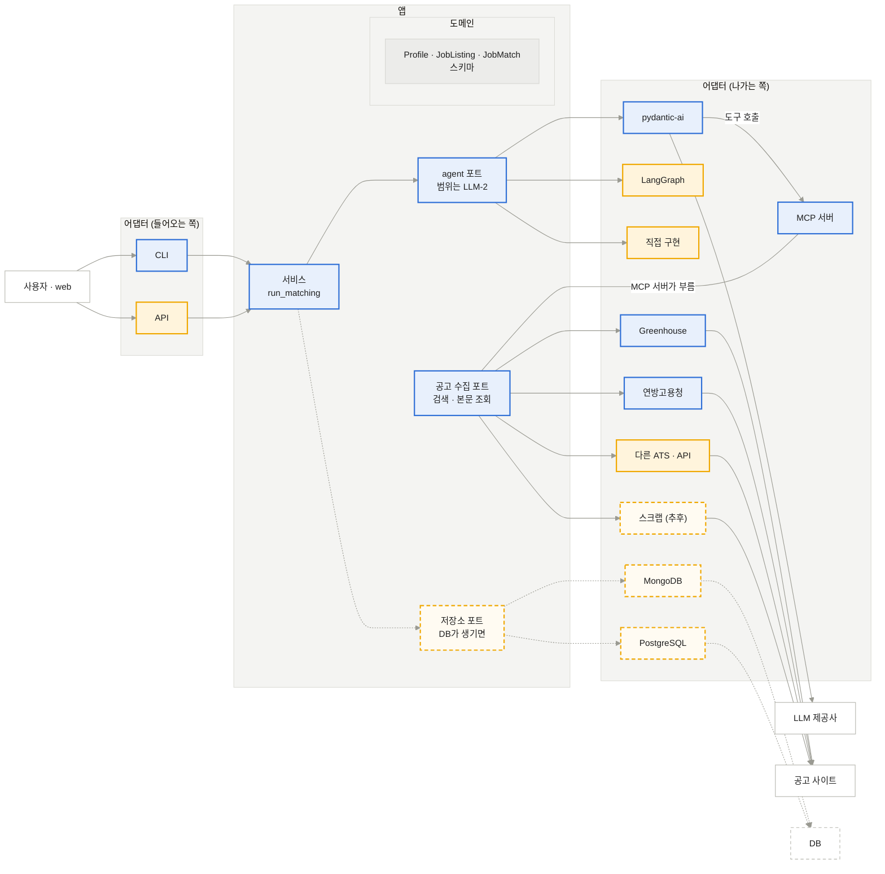
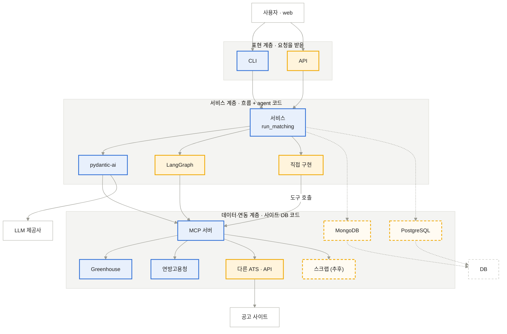
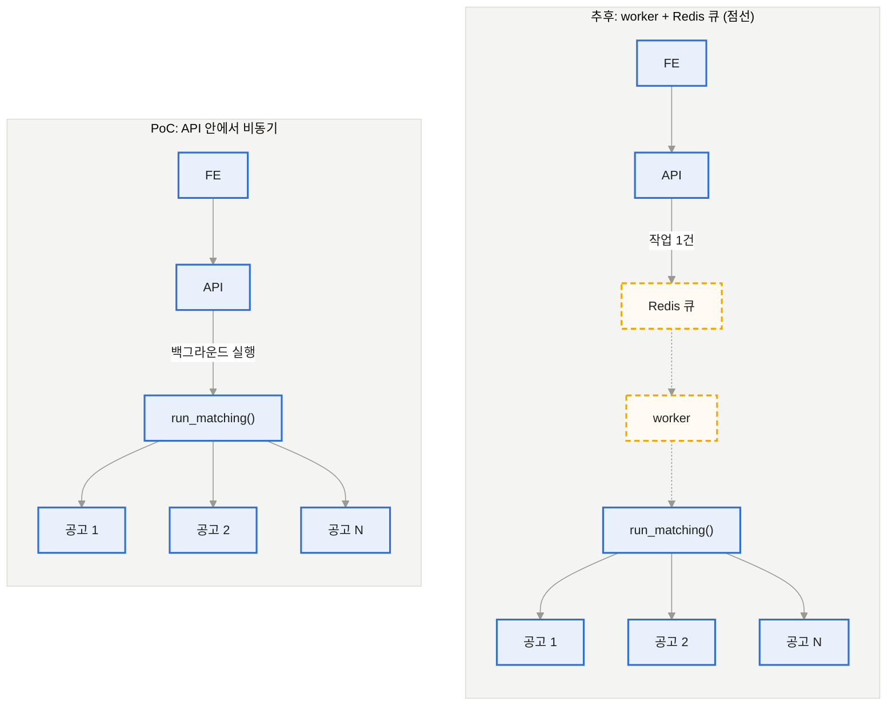
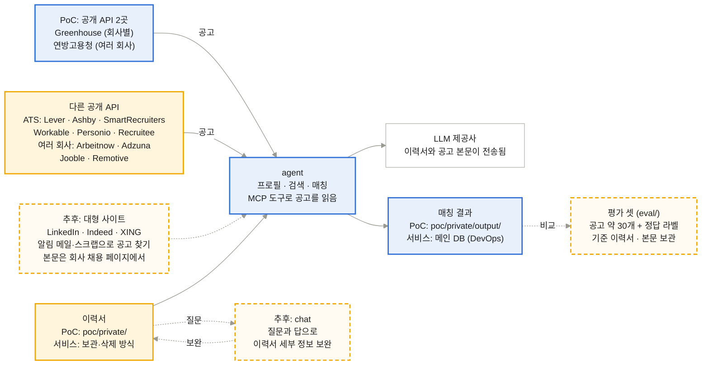

# BE

[메인](README.md) · [BE](BE.md) · [LLM](LLM.md) · [FE](FE.md) · [DevOps](DevOps.md) · [Test](Test.md)

## 1. 아키텍처

헥사고날과 계층형(레이어드) 중 무엇으로 갈지 정함.

### 헥사고날

가운데에 도메인과 서비스를 두고, 바깥과는 포트(인터페이스)로만 주고받는 구조임. 바깥의 실제 구현은 어댑터로 두고 갈아 끼움.

*바깥(사이트 · agent · DB)은 어댑터로 갈아 끼우고, 앱은 포트만 부름* (파랑 PoC · 주황 미정(회의에서 정함) · 주황 점선 추후 · 흰색 외부 · 앱은 포트만 알고, 바깥 구현은 양쪽 어댑터에 있음)

#### 이 프로젝트에 맞는 이유

- **공고 수집:** API 사이트와 스크랩 사이트를 모두 어댑터로 둠. 포트는 공고를 불러오는 부분(검색, 본문 조회)만 정하면 되고, 사이트를 붙일 때는 어댑터만 추가함(BE-3)
- **agent:** pydantic-ai, LangGraph, 직접 구현을 어댑터로 두고 포트는 하나만 둠. agent는 MCP 서버를 통해 공고 수집 포트와 주고받음. 포트를 일 단위로 할지 역할 단위로 할지는 LLM-2에서 정함
- **DB:** 나중에 DB가 생겨도 저장소 포트 + DB 어댑터로 같은 방식임. MongoDB와 PostgreSQL 중 무엇을 고르든 서비스 코드는 그대로임(DevOps-4)
- **테스트:** 포트마다 가짜 어댑터를 끼우면 네트워크나 LLM 없이 서비스를 테스트할 수 있음. CI에서 키 없이 돌릴 수 있음

### 계층형 (레이어드)

층을 위에서 아래로 쌓고, 위 층이 바로 아래 층 코드를 직접 부르는 구조임. 표현(CLI·API) → 서비스(흐름, agent 코드) → 데이터·연동(사이트·DB 코드) 순서임. 도메인 모델은 모든 층이 같이 씀.

*계층형은 위 층이 아래 층 코드를 직접 부름* (파랑 PoC에 있음 · 주황 미정(회의에서 정함) · 주황 점선 추후 · 흰색 외부 · agent를 바꾸면 서비스 코드를 고침 · 도메인 모델(Profile · JobListing · JobMatch, 2번 스키마)은 모든 층이 씀)

### 장단점 비교

| 항목 | 헥사고날 | 계층형 |
| --- | --- | --- |
| 의존 방향 | 바깥 코드가 앱의 포트에 맞춤. 서비스는 사이트·agent·DB 코드를 모름 | 서비스가 사이트·agent·DB 코드를 직접 import함 |
| 사이트·agent·DB 추가·교체 | 어댑터만 추가함. 서비스 코드는 그대로 | 서비스 코드도 같이 고침 |
| 구현 여러 개 비교(LLM-3) | 같은 포트에 어댑터만 바꿔 끼움 | 서비스 안에서 분기하거나 구현마다 서비스를 따로 둠 |
| 테스트 | 가짜 어댑터를 끼워 네트워크·LLM 없이 테스트함 | 외부 호출을 mock으로 가로채야 함 |
| 처음 만드는 양 | 포트와 연결 코드가 더 필요해서 파일이 늘어남 | 코드가 적고 바로 시작할 수 있음 |
| 익히는 데 드는 시간 | 포트·어댑터 개념을 팀 전체가 알아야 함 | 익숙한 구조라 따라가기 쉬움 |

| 정할 것 | 선택지 | 참고 | 결정 |
| --- | --- | --- | --- |
| 코드 구조 | 헥사고날(포트 + 어댑터) / 계층형(레이어드) | 위 장단점 비교 |  |

## 2. 실행 방식

*처음부터 비동기, 같은 run_matching()이 공고별 agent를 병렬로 돌림* (PoC는 B안(미정) · API가 작업 ID를 먼저 돌려주고 같은 프로세스에서 실행 · FE는 작업 ID로 결과를 조회)

- **처음부터 비동기:** 동기 API는 코드가 가장 단순하지만, worker로 가면 작업 상태 조회 API·FE 폴링·결과 저장을 어차피 만들어야 하고 API↔FE 응답 형식도 바꿔야 함. LLM 비용은 같으므로 처음부터 비동기로 함
- **PoC (제안, B안):** API 안에서 비동기. API가 작업 ID를 바로 돌려주고, 같은 프로세스에서 `run_matching()`을 백그라운드로 실행함(FastAPI `BackgroundTasks` 등). 인프라 추가가 없는 대신, API가 재시작되면 진행 중인 작업이 사라짐
- **이후:** worker + Redis 큐. API는 요청당 작업 1건만 큐에 넣고, worker가 꺼내서 같은 `run_matching()`을 실행함
- **회의에서 정할 것:** A. 처음부터 worker + Redis / B. API 안에서 비동기로 시작해 나중에 worker로
- **공통:** FE는 작업 ID로 결과를 조회함. 공고별 agent는 `run_matching()` 안에서 병렬로 돌림. 전체 시간은 대략 ⌈공고 수 / 동시 실행 수⌉ × 공고 하나 처리 시간이고, 동시 실행 수는 LLM 제공자의 호출 한도에 맞춰 정함
- **전환:** B에서 worker로 갈 때 바뀌는 건 `run_matching()`을 누가 부르느냐뿐임. FE와 API 응답 형식은 그대로
- **결정:** (회의에서)

## 3. 데이터

공고를 어디서 받을지, 이력서를 어디에 둘지 정함. 평가 셋은 Test-1에서 다룸. PoC는 공개 API 2곳(Greenhouse, 연방고용청)만 쓰고, 이력서는 저장소에 올리지 않음.

*공고는 공개 API로 받고, 이력서와 결과는 저장소에 올리지 않음* (파랑 확정(PoC) · 주황 미정(회의에서 정함) · 주황 점선 추후 · 흰색 외부 서비스)

### 수집 사이트

공개 API는 두 종류임. ATS는 회사마다 따로 불러야 해서 볼 회사 목록이 필요하고, 여러 회사 API는 여러 회사 공고를 한 곳에서 받음. 아래는 2026-10-16에 직접 호출해서 확인한 결과임.

| 사이트 | 종류 | 접근 | 확인한 것 |
| --- | --- | --- | --- |
| [Greenhouse](https://boards-api.greenhouse.io/v1/boards/getyourguide/jobs) | ATS (회사별) | 공개 API, 키 없음 | PoC에서 사용. 전체 검색 없음 |
| [연방고용청](https://jobsuche.api.bund.dev) | 여러 회사 (독일) | 공개 클라이언트 ID | PoC에서 사용. 키워드·지역 검색. 문서는 커뮤니티 정리본이라 이용 조건 확인 필요. 제휴 사이트 공고는 본문 대신 원문 링크만 있음 |
| [Lever](https://api.lever.co/v0/postings/spotify?mode=json) | ATS (회사별) | 공개 API, 키 없음 | spotify로 확인. 본문 포함 |
| [Ashby](https://api.ashbyhq.com/posting-api/job-board/notion) | ATS (회사별) | 공개 API, 키 없음 | notion으로 확인(129건). 본문 포함 |
| [SmartRecruiters](https://api.smartrecruiters.com/v1/companies/BoschGroup/postings) | ATS (회사별) | 공개 API, 키 없음 | BoschGroup으로 확인(5,067건). 본문은 공고별 상세 조회 |
| [Workable](https://apply.workable.com/api/v1/widget/accounts/huggingface) | ATS (회사별) | 공개 API, 키 없음 | huggingface로 확인. `details=true`면 본문 포함 |
| [Personio](https://personio.jobs.personio.de/xml) | ATS (회사별) | 공개 XML, 키 없음 | personio로 확인. 본문 포함 |
| [Recruitee](https://bunq.recruitee.com/api/offers/) | ATS (회사별) | 공개 API, 키 없음 | bunq로 확인. 본문 포함 |
| [Arbeitnow](https://www.arbeitnow.com/api/job-board-api) | 여러 회사 (유럽) | 공개 API, 키 없음 | 검색 없이 최신 공고를 페이지당 300건씩 받음. 남용 금지, 출처 링크 요청 |
| [Adzuna](https://developer.adzuna.com/overview) | 여러 회사 (여러 나라) | 가입 후 키 발급 | 키가 없어 호출은 못 해 봄. 독일 지원 여부는 공식 문서에서 확인 못 함 |
| [Jooble](https://jooble.org/api/about) | 여러 회사 | 신청서로 키 발급 | 비용·조건은 안내 페이지에 없음 |
| [Remotive](https://remotive.com/api/remote-jobs) | 여러 회사 (원격 근무만) | 공개 API, 키 없음 | 공개 API는 15건뿐이고 24시간 늦게 올라옴. 출처 표기 필수, 하루 4회 이하 권장 |

- **회사 목록:** ATS는 회사별이라 볼 회사와 보드 이름을 알아야 함. 누가 어떻게 등록할지 정함(1번 남은 질문과 같음)
- **이용 조건:** 여러 회사 API는 출처 표기, 호출 횟수 같은 조건이 있음. 붙이기 전에 사이트별로 확인함
- **추후 대형 사이트:** LinkedIn, Indeed, XING 같은 대형 사이트는 알림 메일이나 스크랩으로 공고를 찾고, 본문은 회사 채용 페이지에서 직접 받는 방식으로 추가할 수 있음. 회사 채용 페이지가 위 ATS 중 하나면 같은 어댑터를 그대로 씀. LinkedIn은 [약관 8.2](https://www.linkedin.com/legal/user-agreement)에서 스크래핑과 봇 접근을 금지함. Indeed와 XING 조건은 아직 확인 안 함

### 이력서 보관

- **PoC:** 본인의 이력서를 `poc/private/`에 두고 실행
- **LLM 전송:** 매칭할 때 이력서 본문이 LLM 제공사로 전송됨
- **서비스 이후:** 업로드된 이력서를 저장할지, 처리 후 바로 지울지 정함. 저장하면 보관 기간, 삭제 요청 처리, 접근 권한도 정해야 함. 베를린 기준이라 GDPR 대상임

| 정할 것 | 선택지 | 참고 | 결정 |
| --- | --- | --- | --- |
| 수집 사이트 | PoC 2곳 유지 / ATS 추가 / 여러 회사 API 추가 | 위 표 |  |
| 회사 목록 관리 | 설정 파일 / 화면에서 등록 | 1번 남은 질문 |  |
| 이력서 보관 (서비스) | 처리 후 삭제 / 저장 + 삭제 기능 | GDPR |  |
