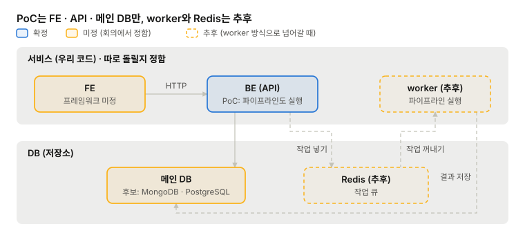
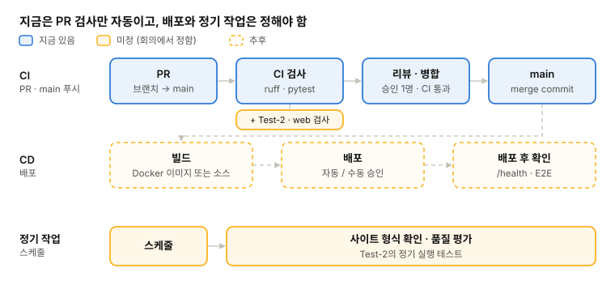
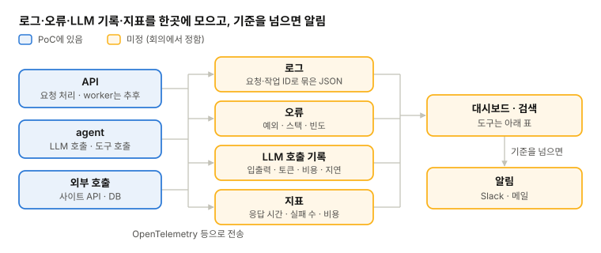

# DevOps

[메인](README.md) · [BE](BE.md) · [LLM](LLM.md) · [FE](FE.md) · [DevOps](DevOps.md) · [Test](Test.md)

## 1. 서비스 구성

- **서비스 구성:** FE / BE(API) / worker를 각각 따로 돌릴지. API와 worker는 같은 코드에 실행 명령만 다르게 함(README 방침). worker를 분리하면 매칭이 오래 걸려도 API가 느려지지 않고, worker만 늘릴 수 있음
- **PoC:** FE + BE 두 서비스만. worker와 Redis는 worker 방식으로 넘어갈 때 추가(BE-2)
- **Redis:** 작업 큐로 사용(BE-2 이후 단계). API가 작업을 넣고 worker가 꺼내서 실행함
- **결정:** (회의에서)

## 2. CI/CD 파이프라인

PR부터 배포까지 무엇을 자동으로 돌릴지 정함. 지금 CI(GitHub Actions)는 PR과 main 푸시 때 Python lint·포맷 검사·pytest만 돌리고, 배포 자동화는 없음.

| 단계 | 지금 | 정할 것 |
| --- | --- | --- |
| PR 검사 | `ruff check`, `ruff format --check`, `pytest` | 테스트 종류(Test-2), web 검사 추가(3번 ③) |
| 빌드 방식 | 없음 (Dockerfile 없음) | Docker 이미지로 빌드·배포 / 소스에서 바로 배포(PaaS·VM). Docker면 로컬·CI·서버 환경이 같아지고 docker compose로 FE·BE·DB를 한 번에 띄울 수 있음 |
| main 병합 후 | 없음 | 배포할 결과물을 자동으로 빌드할지 (Docker면 이미지를 레지스트리에 올림) |
| 배포 | 없음 | 병합하면 자동 배포 / 태그·수동 승인 후 배포 |
| 환경 | 로컬만 | 개발·운영 분리, 스테이징을 둘지 |
| 배포 후 확인 | 없음 | `/health` 헬스 체크와 간단한 E2E로 확인할지 |
| 정기 작업 | 없음 | 사이트 형식 확인과 품질 평가(Test-2)를 정해진 시간에 돌릴지 |
| 비밀 값 | 로컬 `.env` | CI·배포용 키를 GitHub Secrets 등에 둘지. LLM 키 정책은 LLM-5 |

## 3. 배포 대상 (클라우드)

PoC는 각자 로컬에서 실행함. 팀이 같이 쓰거나 밖에 보여 주려면 서버에 올려야 하고, 언제 어디에 올릴지는 추후 정함.

| 방식 | 예 | 장점 | 단점 |
| --- | --- | --- | --- |
| 로컬 (PoC) | 각자 PC, docker compose | 비용 없음 | 팀이 같은 환경·결과를 공유하기 어려움 |
| PaaS | Render, Railway, Fly.io | 저장소나 컨테이너만 연결하면 배포됨 | 쓰는 만큼 비용이 늘고 설정 자유도가 낮음 |
| 관리형 컨테이너 | Cloud Run, AWS ECS(Fargate), Azure Container Apps | 자동 확장, 같은 클라우드의 관리형 DB와 연결이 쉬움 | 권한(IAM)·네트워크 설정을 익혀야 함 |
| VM | AWS EC2, Hetzner 등 | 구조가 단순하고 비용이 일정함 | 보안 패치·백업을 직접 해야 함 |
| Kubernetes | EKS, GKE | 확장성이 가장 큼 | 팀 규모에 비해 운영 부담이 큼 |

- **지역:** 이력서를 저장하면 EU 리전에 두는 게 GDPR 대응이 단순함(BE-3)
- **비용:** 무료 구간과 요금은 서비스마다 다르고 자주 바뀌어서, 고를 때 확인함
- **정할 것:** 올리는 시점, 방식, 비용을 누가 어떻게 부담할지

## 4. DB

메인 DB와 Redis(추후)의 종류와 운영 방식을 정함.

- **메인 DB:** 후보는 MongoDB / PostgreSQL. 이력·공고처럼 형태가 자주 바뀌는 데이터는 MongoDB가 편하고, 공고·이력·매칭 결과를 엮어 조회할 일이 많으면 PostgreSQL이 유리함
- **저장할 것:** 프로필(이력), 공고 본문, 매칭 결과, 작업 상태(BE-2), 평가 결과(Test-1)
- **운영 방식:** 관리형(MongoDB Atlas, Supabase·Neon, AWS RDS 등) / 컨테이너로 직접 운영. 관리형은 백업·업데이트를 맡길 수 있음
- **Redis (추후):** worker 방식으로 넘어갈 때 작업 큐로 씀(BE-2). 메인 DB와 따로 띄움. 관리형(Upstash, Redis Cloud, AWS ElastiCache 등) / 컨테이너로 직접 운영. 작업 상태와 결과는 메인 DB에 저장함(1번 그림)
- **로컬 개발:** 각자 docker compose로 띄울지, 공용 개발 DB를 둘지
- **스키마 변경:** PostgreSQL이면 마이그레이션 도구(Alembic 등)가 필요함. MongoDB도 문서 형식이 바뀌면 옛 데이터를 어떻게 읽을지 정해야 함
- **참고:** LiteLLM 프록시로 사람별 가상 키·예산을 쓰면 프록시용 PostgreSQL이 따로 필요함(LLM-5)

| 정할 것 | 선택지 | 참고 | 결정 |
| --- | --- | --- | --- |
| DB 종류 | MongoDB / PostgreSQL | 2번 스키마 |  |
| 운영 방식 | 관리형 / 직접 운영 | 3번 배포 대상 |  |
| 로컬 개발 DB | 각자 docker compose / 공용 개발 DB |  |  |
| Redis (추후) | 관리형 / 직접 운영 | worker를 도입할 때(BE-2) |  |

## 5. 모니터링과 로그

무엇을 기록하고 어디서 볼지 정함. LLM을 쓰므로 서버 로그 외에 LLM 호출 기록(입출력, 토큰, 비용, 지연, 도구 호출)도 남겨야 원인을 찾을 수 있음.

| 대상 | 남길 것 | 후보 도구 |
| --- | --- | --- |
| 앱 로그 | 요청·작업 ID로 묶은 구조화 로그(JSON) | 클라우드 기본 로그, Grafana Loki |
| 오류 | 예외와 스택, 발생 빈도 | Sentry |
| LLM 호출 | 프롬프트·응답, 토큰·비용, 지연, 도구 호출 순서 | Logfire(pydantic-ai 연동), Langfuse(오픈소스, 직접 운영 가능), LangSmith(LangGraph) |
| 지표 | API 응답 시간, 작업 성공·실패 수, 사이트 API 오류, LLM 일일 비용 | Prometheus·Grafana, 클라우드 기본 지표 |
| 알림 | 작업 실패 급증, 비용 상한 초과 | Slack·메일 |

- **표준:** OpenTelemetry 형식으로 보내면 도구를 나중에 바꾸기 쉬움. pydantic-ai는 OpenTelemetry로 기록을 내보낼 수 있음
- **개인정보:** LLM 호출 기록에 이력서 본문이 남음. 가리기, 보관 기간, 접근 권한을 정해야 함(BE-3)
- **PoC:** 터미널 출력과 `poc/private/output/`의 JSON 파일로만 남김

| 정할 것 | 선택지 | 참고 | 결정 |
| --- | --- | --- | --- |
| LLM 호출 기록 도구 | Logfire / Langfuse / LangSmith / 안 둠 | LLM-3 프레임워크 (Logfire는 pydantic-ai 연동) |  |
| 로그·지표 | 클라우드 기본 기능 / 별도 도구 | 3번 배포 대상 |  |
| 알림 기준 | 실패율, 일일 비용 상한 등 | LLM-5 API 키 |  |
