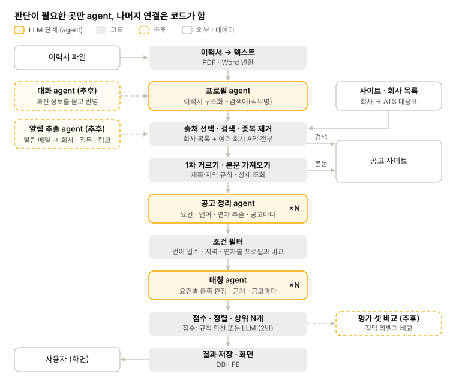
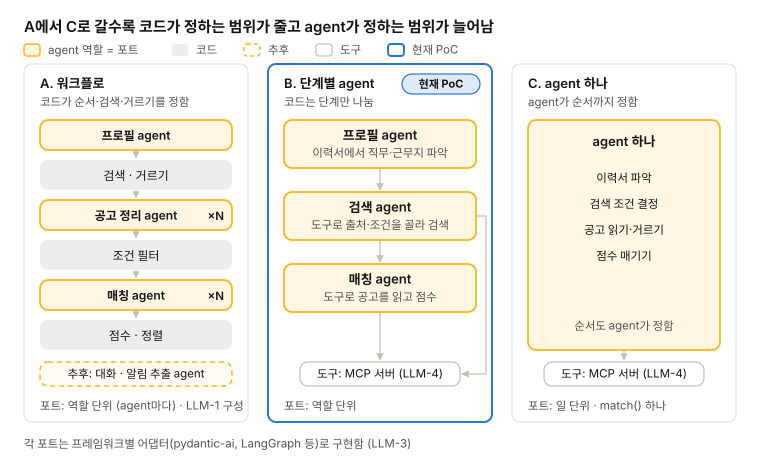
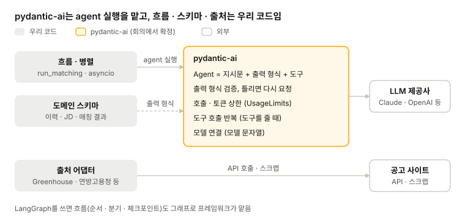
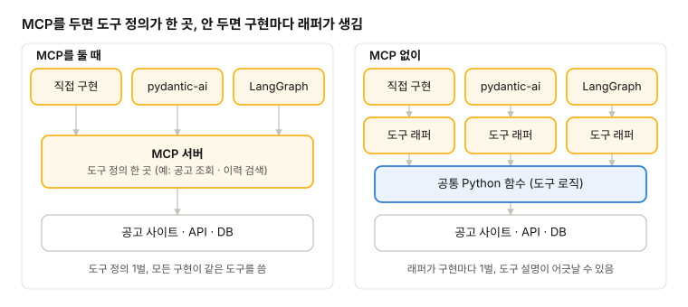
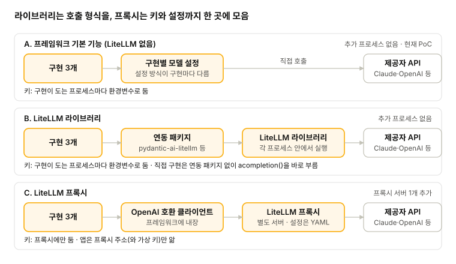

# LLM

[메인](README.md) · [BE](BE.md) · [LLM](LLM.md) · [FE](FE.md) · [DevOps](DevOps.md) · [Test](Test.md)

## 1. agent 구성 (회의에서 정함)

### 기능별 LLM 필요 여부

기능마다 LLM이 필요한지 나누고, 필요한 것만 agent로 둔다고 할 때의 목록.

판단이 필요 없는 출처 선택, 검색, 정렬은 코드가 함.

| 단계 (1번) | 기능 | LLM | 담당 | 이유 |
| --- | --- | --- | --- | --- |
| 1 | 검색할 사이트·회사 목록 관리 | 불필요 | 코드 | 설정 데이터. 회사 → ATS(Applicant Tracking System)  대응표 포함 |
| 2 | 이력서 파일 → 텍스트 | 불필요 | 코드 | PDF·Word 변환 라이브러리 |
| 2 | 이력서 구조화 (직무, 기술, 연차, 언어, 희망 지역) | 필요 | 프로필 agent | 형식이 제각각인 글을 해석해야 함 |
| 3 | 대화로 정보 보충 (추후) | 필요 | 대화 agent | 빠진 정보를 찾아 묻고 답을 반영함 |
| 4 | 검색어 만들기 (직무명, 독일어 직무명) | 필요 | 프로필 agent | 경력에 맞는 직무명을 떠올려야 함 |
| 4 | 출처 선택 | 불필요 | 코드 | ATS는 회사 목록으로 연결, 여러 회사 API는 전부 검색 |
| 4 | 공고 검색·중복 제거 | 불필요 | 코드 | API 호출, 같은 공고 합치기 |
| 4 | 1차 거르기 (제목·지역) | 불필요 | 코드 | 단어·지역 규칙 |
| 4 | 공고 본문 가져오기 | 불필요 | 코드 | 상세 조회, HTML → 텍스트 |
| 4 | 공고 구조화 (필수·우대 요건, 언어, 연차, 근무 형태) | 필요 | 공고 정리 agent | 공고마다 쓰는 방식이 다름(2번 공고 구조화 단계) |
| 5 | 조건 필터 (언어 필수, 지역, 연차) | 불필요 | 코드 | 구조화된 값을 프로필과 비교. 공고 구조화가 없으면 LLM이 본문을 읽어야 함 |
| 5 | 요건별 충족 판정 + 근거 | 필요 | 매칭 agent | 이력과 요건 문장을 비교해 해석해야 함 |
| 6 | 적합도 점수 | 선택 | 코드 또는 매칭 agent | 판정을 규칙으로 합산하면 코드, 전체를 보고 매기면 LLM(2번 점수 계산 방식) |
| 6 | 정렬·상위 N개 | 불필요 | 코드 | 점수로 정렬 |
| 7 | 결과 저장·화면 | 불필요 | 코드 | DB·FE |
| 추후 | 알림 메일에서 회사·직무·링크 추출 | 선택 | 알림 추출 agent 또는 코드 | 메일 형식이 사이트마다 다르면 LLM |
| - | 평가 셋 비교 | 불필요 | 코드 | 정답 라벨은 사람이 붙임 |

- **agent:** 프로필, 공고 정리, 매칭 3개. 추후 대화, 알림 추출 2개
- **도구:** 세 agent 모두 도구가 필요 없음. 입력을 받아 정해진 형식으로 돌려주는 LLM 호출 하나면 됨. MCP를 둘지(LLM-4)도 이 결정에 따라 달라짐
- **자율성:** LLM-2 비교의 A(워크플로)에 가까움. 순서와 검색은 코드가 정하고, agent는 판단만 함
- **합치기:** 공고 정리와 매칭을 공고마다 호출 한 번으로 합칠 수도 있음. 대신 조건 필터에서 걸러질 공고까지 매칭 비용이 듦

### agent를 붙였을 때 흐름

## 2. 흐름과 포트 (자율성)

순서와 판단을 코드가 정할지 agent가 정할지 정함. 포트 범위도 이 선택을 따라감: A·B는 agent 역할마다 포트를 두는 역할 단위, C는 match() 하나만 두는 일 단위임.

현재 PoC는 B임. 아래는 B에서 A 쪽 또는 C 쪽으로 옮길 때의 비교임.

|  | ← A 쪽 (워크플로, 1번 구성안) | C 쪽 (agent 하나) → |
| --- | --- | --- |
| 장점 | 결과가 안정적이고 호출 수·비용이 정해짐. 거르기를 코드가 확실하게 함(PoC에서 독일어 필수 공고가 새던 문제). 단계별로 디버깅·평가가 쉬움 | 코드가 가장 적음. agent가 상황에 맞게 검색 조건과 순서를 바꿈 |
| 단점 | 코드가 늘어남(출처 선택, 중복 제거, 동시 실행). 검색이 규칙대로만 돌아 유연성이 줄어듦 | 실행마다 결과·호출 수가 달라짐. 거르기와 보는 공고 수가 B보다 더 불안정함. 디버깅은 대화 기록을 따라가야 함 |
| 추가할 것 | 공고 정리 agent, 조건 필터·점수 합산 코드, 회사 목록(출처 선택), 1차 거르기 규칙. agent에 도구가 필요 없어 MCP는 선택(LLM-4) | 요청 횟수 상한, agent가 낸 id·링크 검증, 쓸 수 있는 도구 범위 제한, 같은 입력을 여러 번 돌리는 평가, 가드레일 |
| 포트 | 역할 단위 (agent마다) | 일 단위 (match() 하나) |

- **정할 것:** 기본 방식(A·B·C), 또는 단계마다 다르게 할지(예: 검색은 agent, 평가는 고정)

* **결정:** (회의에서)

## 3. agent 구현 (프레임워크)

프레임워크 하나로 개발함. 구현을 여러 개 만들어 비교하지는 않음.

| 후보 | 성격 | 이 작업에 맞는 정도 (A 워크플로 / C agent 하나) |
| --- | --- | --- |
| 직접 구현 (SDK + 코드) | 흐름을 코드로 직접 작성 | A에 잘 맞음. C는 보통(루프를 직접 짜야 함) |
| pydantic-ai | 타입 기반 agent, 구조화 출력이 강함. 흐름은 pydantic-graph, 병렬은 asyncio로 | A·C 둘 다 잘 맞음 |
| LangGraph | 흐름을 그래프로 명시. 병렬 처리, 반복, 체크포인트 | A·C 둘 다 잘 맞음 |
| Google ADK | 순차·병렬·반복 워크플로 agent | A·C 둘 다 맞는 편 |
| LlamaIndex Workflows | 이벤트 기반 워크플로, 검색(RAG)이 강함 | A·C 둘 다 보통. 강점은 검색(RAG) |
| OpenAI Agents SDK | agent 루프 + 위임(handoff) + 가드레일 | C에 맞는 편. A는 보통 |
| CrewAI | 역할을 나눈 agent들의 협업 | A에 보통. C는 보통 이하 |
| Microsoft Agent Framework | 여러 agent의 대화형 협업 (AutoGen 후속) | A에 보통. C는 보통 이하 |
| Claude Agent SDK | Claude Code 기반 자율 agent, Claude 전용 | C에 맞는 편이지만 무거움. A는 덜 맞음 |

### 프레임워크 선택

후보 중 pydantic-ai와 LangGraph가 잘 맞음. LangGraph가 더 나은 점은 실행 중간에 멈췄다 이어 가는 기능인데, 지금 흐름에는 그런 지점이 없어서 pydantic-ai가 맞음. 회의에서 확정함.

| 기준 | pydantic-ai | LangGraph | 우리 시스템 |
| --- | --- | --- | --- |
| 구조화 출력·검증 | 기본 기능. 검증에 실패하면 다시 시도 | 연동해서 씀 | 모든 LLM 단계가 구조화 출력 |
| 가드레일 | 호출·토큰 상한, 출력 검증이 기본 기능 | 노드와 조건으로 직접 구성하는 편 | 필요함. LLM-2의 C 쪽이면 특히 |
| 병렬 | asyncio로 공고마다 동시 실행 | 그래프 병렬 분기 | 공고마다 ×N. 둘 다 됨 |
| 중단·재개 (사람 입력 대기, 체크포인트) | 도구 승인 대기, Temporal·DBOS 등 연동으로 가능 | 그래프 체크포인트가 기본 기능 | 실행 중에 사람이 끼어드는 지점 없음 |
| 분기·반복이 많은 흐름 | 단순한 흐름에 적합 | 강점 | 흐름이 일직선 |
| PoC | 사용 중(MCP 도구·구조화 출력 확인) | 없음 | 그대로 이어 감 |

- **대화 agent(추후):** 사람과 주고받지만 턴마다 대화 기록을 넘기는 방식이라 실행을 멈춰 둘 필요가 없음. pydantic-ai의 대화 기록 전달로 충분함
- **LangGraph를 다시 볼 때:** 실행 중에 사용자 승인을 받아야 하거나, 결과가 적으면 다시 검색하는 반복이 생기거나, 긴 작업을 실패한 지점부터 재개해야 할 때
- **출처:** [pydantic-ai 도구](https://pydantic.dev/docs/ai/realtime/tools/index.md), [deferred tools(승인 대기)](https://pydantic.dev/docs/ai/tools-toolsets/deferred-tools/index.md), [durable execution](https://pydantic.dev/docs/ai/integrations/durable_execution/overview/index.md)

## 4. MCP 서버

MCP 서버는 도구(공고 조회, 이력 검색 등)를 표준 규격으로 내놓는 서버임. 프레임워크가 하나라서(LLM-3) 구현끼리 도구를 맞추려고 둘 필요는 없음.

- **도구가 필요한 경우:** agent가 직접 검색·조회할 때(LLM-2의 B·C)만 필요함. A면 agent에 도구가 없음
- **둘 때:** 도구가 별도 서버로 떨어져 있어서 Claude Desktop·Claude Code 같은 다른 MCP 클라이언트도 같은 도구를 씀. 대신 서버 프로세스가 하나 더 생기고, 도구 입출력이 JSON으로 오감
- **안 둘 때:** pydantic-ai가 Python 함수를 바로 도구로 씀. 프로세스가 하나라 디버깅이 쉬움. MCP가 필요해지면 같은 함수 위에 MCP 서버를 얹으면 됨
- **전송 방식 (둘 경우):** stdio는 agent가 MCP 서버를 서브프로세스로 직접 띄워서 따로 켜 둘 필요가 없음. Streamable HTTP는 서버로 띄워 두고 여러 곳에서 같이 씀
- **PoC 확인:** `feat/poc-mcp-agent` 브랜치에서 FastMCP stdio 서버(Greenhouse 공고 조회 도구 2개)를 pydantic-ai가 호출하는 것까지 동작 확인함

| 정할 것 | 선택지 | 결정 |
| --- | --- | --- |
| MCP 서버 | 둔다 / 안 둔다 |  |
| 전송 방식 (둘 경우) | stdio / Streamable HTTP |  |
| 도구 목록 | 예: 공고 목록 조회, JD 조회, 이력 검색 |  |

## 5. 모델과 키

모델을 어디서 바꾸고 API 키를 어디에 둘지 정함.

### LiteLLM이 하는 일

- 핵심은 `litellm.completion()` 하나임. OpenAI 형식 요청을 받아 Anthropic·Gemini 등 제공자별 형식으로 바꿔 줌
- 프록시는 이 라이브러리를 서버로 감싼 것. OpenAI 호환 API를 내주므로 프레임워크에 원래 있는 OpenAI 클라이언트로 붙음
- 라이브러리로 쓰면 pydantic-ai 규격(`Model`)과 이어 줄 연동 패키지(`pydantic-ai-litellm`)가 필요함

### 방식별 비교

|  | A. 프레임워크 기본 기능 | B. LiteLLM 라이브러리 | C. LiteLLM 프록시 |
| --- | --- | --- | --- |
| pydantic-ai | 내장 (`anthropic:claude-haiku-5-5`) | `pydantic-ai-litellm` 추가 | 내장 OpenAI 클라이언트 |
| 모델 바꾸기 | 모델 문자열 (`anthropic:claude-haiku-5-5`) | LiteLLM 모델 문자열 (`anthropic/claude-haiku-5-5`) | 프록시 설정의 별칭 (`haiku`) |
| API 키 위치 | 앱 프로세스 | 앱 프로세스 | 프록시에만 |
| 추가로 띄울 것 | 없음 | 없음 | 프록시 서버 1개 |
| 팀 공용 관리 (사람별 가상 키·예산·호출 로그) | 없음 | 없음 | 있음. 가상 키·예산은 프록시에 DB(PostgreSQL)가 필요함 |
| PoC에서 확인한 것 | 현재 PoC 방식 | `pydantic-ai-litellm` 0.2.8로 MCP 도구 호출·구조화 출력 동작. pydantic-ai의 openai extra를 빼면 앱과 같은 가상환경에 설치 가능 | 구조화 출력이 도구 호출로 바뀌고 thinking 토큰 0, 응답에 비용 정보 없음. |

### LiteLLM이 필요한 경우

- 제공자 하나면 LiteLLM이 하는 일이 거의 없음. pydantic-ai가 Anthropic을 바로 부름
- 제공자를 바꿀 때도 pydantic-ai가 Anthropic·OpenAI·Gemini 등을 내장하고 있어서 모델 문자열과 설치 extra만 바꾸면 됨
- 팀이 키 하나를 같이 쓰거나 사람별 예산·로그가 필요하면 C. 프록시를 어디에 띄우고 누가 관리할지도 같이 정해야 함
- 구독(Claude Pro·Max) 인증: Claude Agent SDK에서만 쓸 수 있고 프록시를 거칠 수 없음

기본 모델 참고: 같은 질의 1회 비용이 Haiku 5.5 약 \$0.002, Opus 5.5 약 \$0.078 (PoC 측정).

| 정할 것 | 선택지 | 결정 |
| --- | --- | --- |
| 모델 전환 방식 | 프레임워크 기본 기능 / LiteLLM 라이브러리 / LiteLLM 프록시 |  |
| API 키 | 개인 키 / 프로젝트 공용 키(평가·CI용 포함) |  |
| 기본 모델 | 후보: Haiku 5.5, Sonnet 5.5 등 |  |
