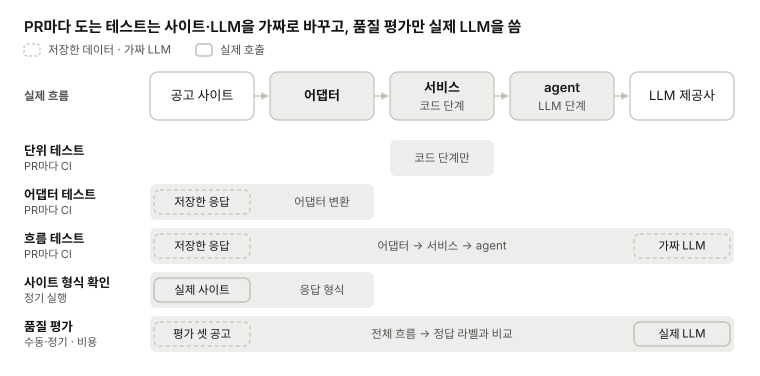

# Test

[메인](README.md) · [BE](BE.md) · [LLM](LLM.md) · [FE](FE.md) · [DevOps](DevOps.md) · [Test](Test.md)

## 1. 평가 셋 (추후)

- **지금 계획:** `eval/` README에 "실제 공고 약 30개 + 지원할 만한가 정답 라벨", 담당 LLM2·PO로 적혀 있음
- **기준 이력서:** 누구 이력서로 라벨을 달지 정함. 실제 이력서는 공개 저장소에 올릴 수 없음
- **공고 본문 보관:** 공고는 마감되면 내려가서, 본문을 따로 저장해야 같은 평가를 다시 돌릴 수 있음. 저장 위치는 사이트 이용 조건과 같이 봄
- **라벨 형식:** 지원/보류 같은 범주로 할지, 점수(0\~100)로 할지. agent 점수와 어떻게 비교할지도 같이 정함

| 정할 것 | 선택지 | 참고 | 결정 |
| --- | --- | --- | --- |
| 평가 셋 이력서 | 가짜 이력서 / 팀원 이력서 (비공개 보관) | 공개 저장소 |  |
| 라벨 형식 | 범주 / 점수 | 2번 매칭 결과 스키마(점수) |  |

## 2. 테스트 방식

LLM이 들어가면 같은 입력에도 결과가 달라질 수 있음. 그래서 코드가 맞는지 보는 테스트와 매칭 품질을 보는 평가를 나눔.

| 종류 | 확인하는 것 | LLM·네트워크 | 언제 |
| --- | --- | --- | --- |
| 단위 테스트 | 코드 단계: 1차 거르기 규칙, 중복 제거, 정렬, 점수 합산 | 없음 | PR마다 CI |
| 어댑터 테스트 | 사이트 응답 → 공고 변환. 저장해 둔 응답 파일로 확인 | 없음 | PR마다 CI |
| 흐름 테스트 | 가짜 LLM(고정 응답)으로 흐름이 끝까지 돌고 출력이 스키마에 맞는지. pydantic-ai는 `TestModel`을 제공함 | 가짜 LLM | PR마다 CI |
| 사이트 형식 확인 | 실제 사이트 API 응답 형식이 바뀌었는지 | 네트워크 | 정기 실행, CI 밖 |
| 품질 평가 (Test-1) | 정답 라벨과 매칭 결과 비교 | 실제 LLM·키, 비용 있음 | 수동 또는 정기 |
| E2E | FE → API → 결과까지 | 선택 | 배포 전 |

| 정할 것 | 선택지 | 참고 | 결정 |
| --- | --- | --- | --- |
| CI에서 실제 LLM 호출 | 안 함(가짜 LLM만) / 일부 테스트만 | 키·비용. LLM-5의 API 키 |  |
| 저장해 둔 사이트 응답 | 저장소에 올림 / 비공개로 보관 | 사이트 이용 조건(BE-3) |  |
| 품질 평가 | 실행 주기와 기준, PR 병합 조건으로 쓸지 | Test-1 |  |
| web 테스트 | CI에 넣음 / 안 넣음 | 3번 ③ CI 검사 범위 |  |
