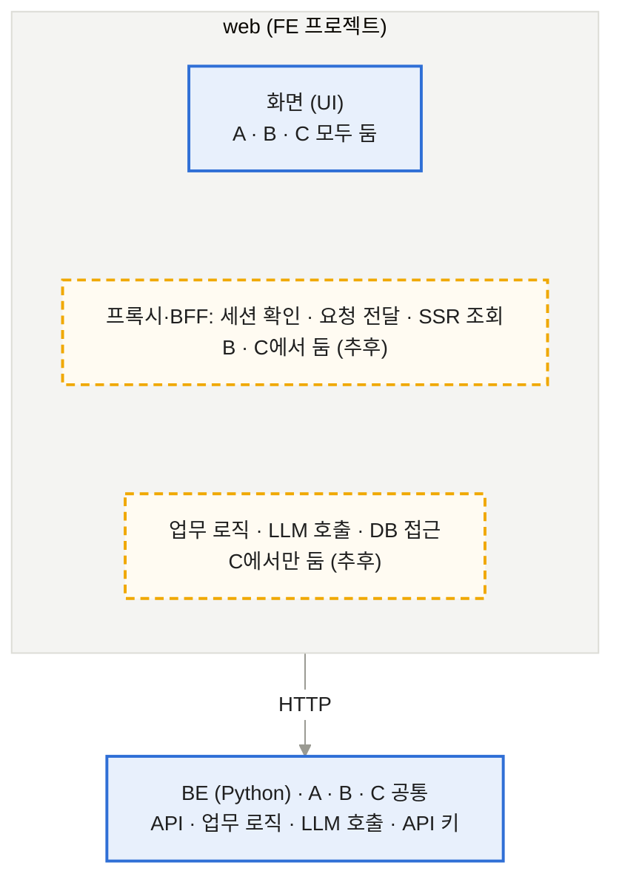

# FE

[메인](README.md) · [BE](BE.md) · [LLM](LLM.md) · [FE](FE.md) · [DevOps](DevOps.md) · [Test](Test.md)

## 1. FE

Next.js 같은 FE 프레임워크는 API 라우트나 서버 컴포넌트로 서버 코드도 돌릴 수 있음. 그래서 프레임워크와 함께, web 프로젝트 안에 서버 코드를 어디까지 둘지 정해야 함.

*PoC는 화면만(A), 프록시·BFF(B)와 로직·LLM(C)은 추후* (A = 화면만 (PoC) · B = 프록시·BFF까지 · C = 제한 없음 (B·C는 추후))

- **A. web은 화면만 (PoC):** 모든 로직과 LLM 호출은 Python BE에 두고, web은 FastAPI만 호출함. 로직·언어·API 키가 한 곳에 있음. 대신 화면에 필요한 데이터 가공도 BE API로 만들어야 함
- **B. 프록시·BFF만 허용 (추후):** 로그인 세션 처리, 요청 전달, 서버 렌더링용 데이터 조회만 web에 둠. 업무 로직과 LLM 호출은 금지. 로직은 BE에 모이지만 "어디까지가 프록시·BFF인지" 선을 합의해야 함
- **C. 제한 없음 (추후):** web에서도 DB 접근과 LLM 호출을 허용함. FE 담당이 혼자 빠르게 만들 수 있지만, agent가 두 언어로 생기고 키 관리·배포 지점이 둘로 늘어남
- **참고:** PR #2의 web 데모에 TypeScript로 된 API(`app/api/chat`)와 agent(`lib/agents`)가 들어 있어서, 이 안건에 따라 처리 방향이 달라짐. 결정하면 3번 협업 규칙의 "BE·LLM 코드 위치"도 같이 정해짐

| 정할 것 | 선택지 | 참고 | 결정 |
| --- | --- | --- | --- |
| FE 프레임워크 | 후보 정리 필요 | main의 web README는 미정. PR #2의 Next.js 데모는 합의 전 |  |
| web의 서버 로직 허용 범위 | PoC는 A(화면만). B·C는 추후 필요해지면 검토 | 위 그림 참고 |  |
