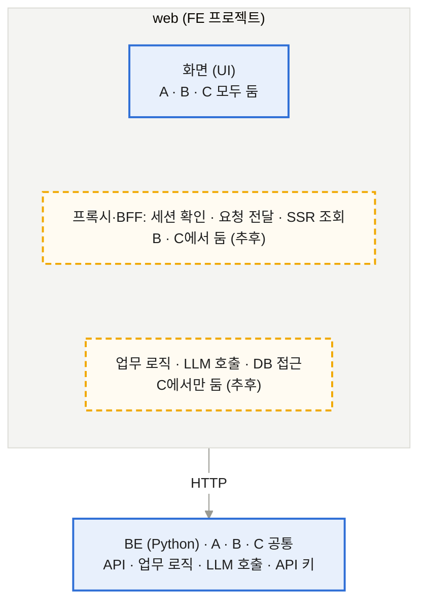

# FE

[메인](README.md) · [BE](BE.md) · [LLM](LLM.md) · [FE](FE.md) · [DevOps](DevOps.md) · [Test](Test.md)

## 1. FE

Next.js 같은 FE 프레임워크는 API 라우트나 서버 컴포넌트로 서버 코드도 돌릴 수 있음. 그래서 프레임워크와 함께, web 프로젝트 안에 서버 코드를 어디까지 둘지 정해야 함.

*PoC는 화면만(A), 프록시·BFF(B)와 로직·LLM(C)은 추후* (A = 화면만 (PoC) · B = 프록시·BFF까지 · C = 제한 없음 (B·C는 추후))

